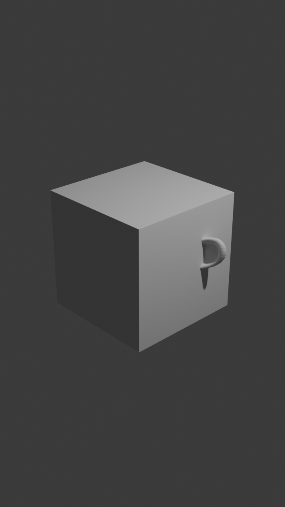

# 00 · Audit dell'ambiente e del repository

Data: 18/11/2026 · Ramo: `feature/animation-studio`

## Decisioni prese
- Blender 5.3 installato come modulo Python (`bpy` da PyPI) in `/opt/blender-env`, gratis, con il sì del 18/11.
- Librerie grafiche di sistema (Mesa/EGL) installate da apt, gratis, per il rendering senza schermo.
- Nessun servizio a pagamento, nessun account creato.

## Questioni aperte
- Il rendering "bello" di Blender è lento in questo container (vedi tabella): serve decidere dove renderizzare (Fase 2).
- I siti di asset gratuiti (Mixamo, Quaternius, Poly Haven, Kenney, Pixabay, Freesound) sono bloccati dalla rete di
  questo ambiente. Raggiungibili: GitHub, npm, PyPI, apt.

## Repository
| Area | Stato | File |
|---|---|---|
| App | Vite 8 + React 19 + TS strict, PWA | `src/`, `vite.config.ts` |
| Dati | localStorage, nessun database | `src/lib/store.ts` |
| Lezioni | 14 pacchetti JSON (4.1–7.3) dai PDF | `src/data/lessons/` |
| Dialoghi Marco/Luca | 14, con tag di enfasi | `src/data/dialogues/` |
| Audio | 14 lezioni, ElevenLabs v4 (George / Will) | `public/audio/`, `src/data/audio/`, `scripts/gen-audio.ts` |
| Cartone attuale | SVG disegnato nel telefono, guidato dall'audio | `src/Cartoon.tsx` |
| Prototipo 3D | Three.js procedurale, render a fotogrammi, 30 s | `studio/` |
| Funzioni server | Vercel (OpenAI, fallback Claude), maxDuration 300 s | `api/` |
| Test | Vitest: game, logic, schedule | `src/lib/*.test.ts` |

## Flusso attuale
PDF → `/api/lezione` (LLM, schema Zod) → pacchetto lezione → dialogo scritto (a mano/LLM, `scripts/check-dialogue.ts`)
→ `scripts/gen-audio.ts` (una richiesta per battuta, pause, ffmpeg) → manifest con i tempi delle battute →
`Cartoon.tsx` (bocca a onde finché la battuta dura) o "Solo ascolto".
Il prototipo usa invece `/v1/text-to-speech/{voice}/with-timestamps`: tempi per carattere → visemi.

## Costi noti
| Voce | Costo | Note |
|---|---|---|
| ElevenLabs Creator | già pagato, rinnovo da disdire entro 18/12 | ~0,455 crediti per carattere; 30 s di voce ≈ 200 crediti |
| OpenAI | crediti già comprati | analisi PDF, tutor |
| Vercel Hobby | 0 € | |
| Blender, Three.js, ffmpeg, Playwright | 0 € | open source |

## Capacità dell'ambiente (misurate)
| Prova | Risultato |
|---|---|
| CPU / RAM / GPU | 4 core, 15 GB, **nessuna GPU** |
| Chromium + Playwright + WebGL software | sì: 932 fotogrammi 720×1280 in pochi minuti (prototipo) |
| ffmpeg | sì |
| Blender Workbench (piatto) | 0,6 s a fotogramma (360×640) |
| Blender Cycles, 32 campioni + denoise, 720×1280 | **~7,3 s a fotogramma** → 2 min di video ≈ 7 ore |
| Blender EEVEE (software) | ~42 s a fotogramma → non usabile qui |
| Siti di asset gratuiti | bloccati; GitHub/npm/PyPI ok |

[Certo] I tempi sono misurati su una scena di prova semplice; con personaggi e scena completa saranno più alti.
[Probabile] Su un Mac con Apple Silicon lo stesso fotogramma EEVEE scende sotto 1 s: se un giorno vuoi, il render
finale si può fare lì; non serve per il pilota.

