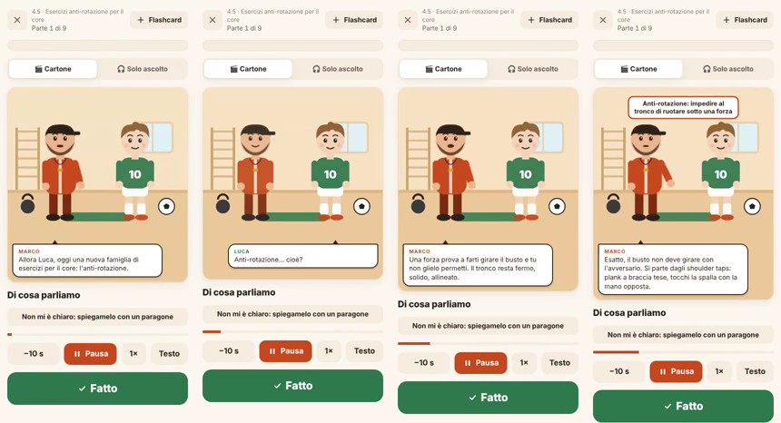
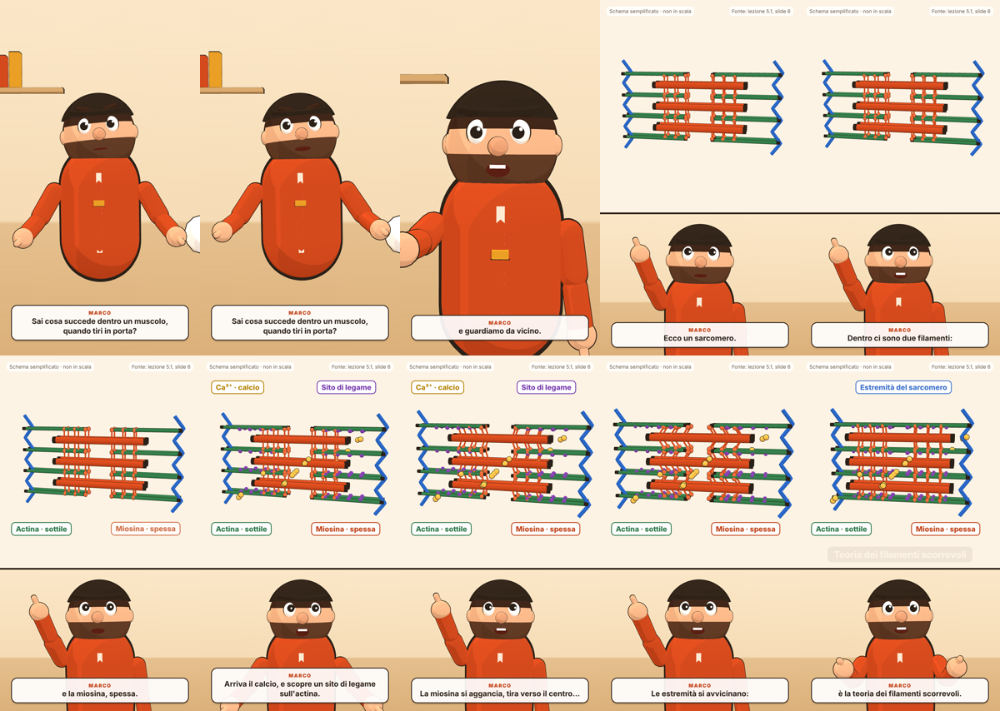

# 01 · Diagnosi della qualità attuale

## Decisioni prese
- Prove: fotogrammi del cartone SVG (lezione 4.5, parte 1) e del prototipo 3D di 30 s.

## Questioni aperte
- Nessuna: le cause sono chiare, le soluzioni vanno decise in Fase 2.

## Difetti e cause

| # | Difetto | Dove | Causa alla radice | Tipo |
|---|---|---|---|---|
| 1 | Bocca che si muove a caso, non sulle sillabe | SVG | La bocca segue onde sinusoidali finché la battuta dura; il manifest audio ha solo l'inizio delle battute, non i tempi delle lettere | Locale (servono timestamp per carattere) |
| 2 | Personaggi fermi, solo un braccio che oscilla | SVG | Pose fisse in SVG, un solo gesto in CSS, nessuno scheletro | Architettura |
| 3 | Inquadratura unica per tutta la lezione | SVG | Scena fissa, nessuna regia | Architettura |
| 4 | Nessuna immagine del concetto (solo cartelli di testo) | SVG | Il cartone non ha visualizzazioni scientifiche | Architettura |
| 5 | Personaggi senza gambe, mani a palla, proporzioni da pupazzo | 3D | Modelli fatti con primitive in Three.js, senza scultura né rig | Architettura (asset) |
| 6 | Volto poco espressivo (sopracciglia, bocca a ellisse) | 3D | Nessun facial rig: solo scala di una sfera | Architettura (asset) |
| 7 | Gesti meccanici, pose che si ripetono | 3D | Pose a mano in codice, nessuna libreria di gesti, nessun overlapping | Locale + asset |
| 8 | Luca assente | 3D | Il prototipo aveva un solo personaggio | Locale |
| 9 | Nessuna storia tra le puntate | entrambi | Ogni parte è isolata; manca bibbia e registro di continuità | Architettura (contenuto) |
| 10 | Nessun richiamo attivo dentro il video | entrambi | Struttura della scena non definita | Locale (struttura 4.4) |
| 11 | Ritmo uniforme, niente gancio, niente gag | entrambi | Dialoghi scritti come lezione, non come puntata | Locale (scrittura) |

## Cosa funziona già e si tiene
- Voci (George e Will) con tag di enfasi; timestamp per carattere → lip-sync (prototipo).
- Sarcomero procedurale, eventi legati alle parole, etichette e fonte a schermo.
- Rendering deterministico a fotogrammi + ffmpeg: ripetibile e gratuito.
- Pacchetti lezione con fonti, carte e quiz dell'app: il richiamo può finire lì.

## Sintesi
I difetti locali (lip-sync, struttura della puntata, scrittura) si risolvono senza cambiare tecnologia. Quelli che
pesano di più (personaggi senza rig e senza volto, nessuna regia) richiedono **asset veri**: personaggi modellati e
riggati in Blender, con shape key per bocca ed espressioni, poi animati e renderizzati.
